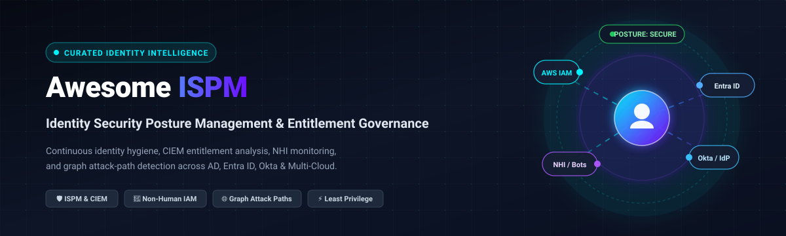

# Awesome Identity Security Posture Management (ISPM)

  

  
  
  
  
  
  

A curated directory and reference landscape of premier **Identity Security Posture Management (ISPM)** platforms 🛡️, **Cloud Infrastructure Entitlement Management (CIEM)** engines ☁️, Non-Human Identity (NHI) governance tools 🤖, and open-source identity attack-path scanners 🔍.

Identity Security Posture Management (ISPM) empowers organizations to continuously discover, evaluate, and remediate security risks across human, machine, and non-human identities. These tools detect excessive privileges ⚠️, dormant and orphaned accounts 👻, toxic permission combinations ⚡, privilege escalation vectors 🪜, and policy misconfigurations across Active Directory, Microsoft Entra ID, Okta, and multi-cloud environments (AWS, Azure, GCP) before adversaries exploit them.

---

## 📑 Table of Contents

- [📈 Sector Overview & Market Dynamics](#-sector-overview--market-dynamics)
- [🏢 SaaS / Hosted Platforms](#-saas--hosted-platforms)
- [🔓 Open-Source GitHub Projects](#-open-source-github-projects)
  - [📊 Open-Source Tool Comparison](#-open-source-tool-comparison)
  - [🔎 Detailed Tool Breakdown](#-detailed-tool-breakdown)
- [⚖️ Open-Source vs Commercial Trade-Offs](#️-open-source-vs-commercial-trade-offs)
- [🤝 How to Contribute](#-how-to-contribute)
- [💖 Support & Sponsorship](#-support--sponsorship)
- [⭐ Star History](#-star-history)
- [⚠️ Disclaimer & Security Advisories](#️-disclaimer--security-advisories)

---

## 📈 Sector Overview & Market Dynamics

The global **Identity Security Posture Management (ISPM)** market is valued at approximately **$13.7 billion to $16.7 billion** and is projected to expand to **$33.1 billion by 2029** (and over **$80 billion by 2034**), registering a strong Compound Annual Growth Rate (CAGR) of **19.3% to 19.6%** 🚀. 

The sector is currently **moderately fragmented but consolidating rapidly toward hybrid exposure platforms**, marked by aggressive acquisitions from established security and identity juggernauts (e.g., Okta acquiring Spera Security, Delinea acquiring Authomize, ServiceNow acquiring Veza, SailPoint acquiring Entro Security, and Silverfort acquiring Rezonate). While specialized startups pioneer deep non-human identity (NHI) governance and graph analytics, market momentum is shifting toward consolidated "winner-take-most" suites that unify ISPM, ITDR (Identity Threat Detection & Response), and CIEM under holistic exposure management ecosystems.

---

## 🏢 SaaS / Hosted Platforms

The following table summarizes enterprise ISPM and identity governance platforms, sorted in descending order by parent company scale (valuation or market capitalization):

| Company / Product | Company Size (Valuation / Market Cap) 🌐 | Starting Tier Pricing 💳 | Free Tier Limit / Free Trial 🎁 | Key Capabilities & Architecture ⚙️ |
| :--- | :--- | :--- | :--- | :--- |
| **[CrowdStrike Falcon Next-Gen Identity Security](https://www.crowdstrike.com/)** | ~$250B Market Cap (FY26 Rev: ~$4.8B) | £19.00 – £46.00 / user / year (G-Cloud baseline; modular quote) | 15-day free trial (full Falcon console testing & Identity Risk Review) | Unified ITDR, ISPM, and identity attack path analysis across Active Directory, Entra ID, Okta, and 150+ SaaS applications. |
| **[Tenable Identity Exposure](https://www.tenable.com/)** | ~$2.6B – $5.4B Market Cap (FY25 Rev: ~$1.0B) | ~£23.14 / license (~$30 / enabled user / year via G-Cloud framework) | 30-day guided enterprise Proof of Concept (PoC) | Real-time Active Directory and Entra ID misconfiguration detection, privilege escalation tracking, and exposure scoring. |
| **[Veza](https://www.veza.com/)** | $1.0B Acquisition Valuation (Acquired by ServiceNow; prior Series D: $808M) | ~$100,000 / year base platform tier (or custom scoped identity packages) | 30-day guided Proof of Concept (PoC) with interactive demo environment | Canonical identity graph mapping access to data systems, SaaS, and multi-cloud infrastructure with continuous privilege reviews. |
| **[Silverfort](https://www.silverfort.com/)** | $1.0B Valuation (Series D Unicorn) | ~£636 / user / year (G-Cloud Core listing; modular packages from £5–£500+) | Complimentary Identity Risk Assessment (AD hygiene & service account discovery) | Agentless inline identity security, runtime access protection, universal MFA, and automated non-human identity (NHI) monitoring. |
| **[ConductorOne](https://www.conductorone.com/)** | ~$350M – $500M Valuation (Series B; $111M total funding) | $100,000 / 12-month platform contract (AWS Marketplace listing; SKU-based on managed identities) | Guided enterprise Proof of Concept (custom pilot environment) | AI-native identity governance, just-in-time (JIT) access requests, self-service privilege management, and automated access reviews. |
| **[Entro Security](https://www.entro.security/)** | ~$200M Acquisition Valuation (Acquired by SailPoint; $24M raised) | Custom enterprise quote (tiered by monitored secrets/NHI volume; starting ~$15k–$25k/yr) | 14-day guided sandbox pilot / NHI Risk Assessment | Non-human identity (NHI) posture management discovering API keys, tokens, and service accounts with vault integration. |
| **[Spera Security](https://www.spera.io/)** | ~$80M – $130M Acquisition Valuation (Acquired by Okta; $58M cash consideration) | Integrated into Okta Identity Governance / custom quote add-on | Okta enterprise customer trial (or 30-day guided product demonstration) | Multi-cloud and SaaS identity posture management, dormant user remediation, and cross-IdP policy violation analysis. |
| **[Authomize](https://www.authomize.com/)** | ~$50M – $70M Acquisition Valuation (Acquired by Delinea) | Integrated into Delinea Platform (modular starting enterprise packages) | 14-day interactive guided evaluation / testbed sandbox | Continuous privilege analysis, toxic combination detection across SaaS, IaaS, and IAM, plus open-source Open-ITDR framework. |
| **[Rezonate](https://www.rezonate.io/)** | ~$30M – $45M Acquisition Valuation (Acquired by Silverfort; $9M seed) | Bundled into Silverfort Advanced/Enterprise or custom cloud-identity quote | Guided cloud infrastructure Proof of Concept (PoC) / Risk Evaluation | Cloud identity security posture management (ISPM) detecting cloud entitlements, toxic privilege paths, and IAM drift across AWS/GCP/Azure. |
| **[Oort](https://www.oort.io/)** | ~$25M – $40M Acquisition Valuation (Acquired by Cisco; $15M raised) | Integrated into Cisco Identity Intelligence / Security Cloud enterprise tiers | Guided Cisco partner pilot / 14-day guided proof of concept | Identity threat detection, authentication posture checks, and behavioral anomaly detection across hybrid identity providers. |

---

## 🔓 Open-Source GitHub Projects

Open-source tooling is indispensable for building custom identity graphs, auditing cloud permissions, generating least-privilege IAM policies, and automating multi-cloud posture checks.

### 📊 Open-Source Tool Comparison

The table below is sorted in descending order by GitHub stargazers:

| Repository 📦 | GitHub_Stars ⭐ | Primary Purpose 🎯 | Supported Environments 🌐 | License 📜 |
| :--- | :--- | :--- | :--- | :--- |
| **[prowler-cloud / prowler](https://github.com/prowler-cloud/prowler)** |  | Multi-Cloud Security Assessment & IAM Compliance Auditing | AWS, Azure, GCP, Kubernetes | Apache-2.0 |
| **[nccgroup / ScoutSuite](https://github.com/nccgroup/ScoutSuite)** |  | Multi-Cloud Security Auditing & IAM Posture Snapshot | AWS, Azure, GCP, Alibaba Cloud, OCI | GPL-2.0 |
| **[duo-labs / cloudmapper](https://github.com/duo-labs/cloudmapper)** |  | AWS IAM Visualization, Resource Mapping & Misconfiguration Scanner | AWS | Open-Source |
| **[lyft / cartography](https://github.com/lyft/cartography)** |  | Cross-Boundary Graph Exploration & Asset Relationship Graph | AWS, Azure, GCP, Okta, GitHub, K8s | Apache-2.0 |
| **[salesforce / cloudsplaining](https://github.com/salesforce/cloudsplaining)** |  | AWS IAM Policy Analysis & Least-Privilege Risk Scoring | AWS | Apache-2.0 |
| **[salesforce / policy_sentry](https://github.com/salesforce/policy_sentry)** |  | Least-Privilege IAM Policy Generation & Role Scoping | AWS | MIT |
| **[Azure / Stormspotter](https://github.com/Azure/Stormspotter)** |  | Azure & Entra ID (Azure AD) Graph Attack Path Modeling | Azure, Microsoft Entra ID | MIT |
| **[nccgroup / PMapper](https://github.com/nccgroup/PMapper)** |  | AWS IAM Privilege Escalation Graph & Role Chain Resolution | AWS | AGPL-3.0 |
| **[Netflix / repokid](https://github.com/Netflix/repokid)** |  | Automated AWS IAM Least-Privilege Role Right-Sizing / Aardvark | AWS | Apache-2.0 |
| **[cyberark / SkyArk](https://github.com/cyberark/SkyArk)** |  | Cloud Steal-the-Token & Privileged Entity Discovery | AWS, Azure | MIT |
| **[wso2 / product-is](https://github.com/wso2/product-is)** |  | Enterprise IAM Platform & SCIM/Adaptive Auth Foundation | On-Premises, Cloud, Hybrid | Apache-2.0 |
| **[BishopFox / iam-vulnerable](https://github.com/BishopFox/iam-vulnerable)** |  | Vulnerable AWS IAM Infrastructure for Security Testing & Benchmarks | AWS | MIT |
| **[authomize / open-itdr](https://github.com/authomize/open-itdr)** |  | Open Specification & Schema for Identity Threat Detection & Response | Cross-Platform, Multi-IdP | Apache-2.0 |
| **[hanzoai / iam](https://github.com/hanzoai/iam)** |  | AI-First IAM Platform with SCIM, WebAuthn, and RBAC | Cloud, Microservices | Apache-2.0 |
| **[nirjxr26 / Bastion](https://github.com/nirjxr26/Bastion)** |  | Self-Hosted IAM Platform with Dynamic RBAC & Risk Scoring | Self-Hosted, Cloud | MIT-style |

---

### 🔎 Detailed Tool Breakdown

#### 1. [Prowler](https://github.com/prowler-cloud/prowler) 🛡️

* **Description:** An industry-standard multi-cloud security assessment and auditing tool covering AWS, Azure, GCP, and Kubernetes. Features hundreds of built-in compliance checks covering CIS Benchmarks, ISO 27001, and GDPR, with deep inspections of IAM permissions, root account hygiene, MFA enforcement, and credential rotation.
* **Best For:** Automated compliance reporting and baseline cloud security hygiene auditing.

#### 2. [ScoutSuite](https://github.com/nccgroup/ScoutSuite) 🔍

* **Description:** An open-source multi-cloud auditing tool from NCC Group. Gathers configuration details across AWS, Azure, GCP, Alibaba Cloud, and Oracle Cloud, generating an interactive offline HTML report that highlights privilege exposures and policy anomalies.
* **Best For:** Security consultants and internal audit teams conducting point-in-time posture assessments.

#### 3. [CloudMapper](https://github.com/duo-labs/cloudmapper) 🗺️

* **Description:** Originally created by Duo Security to visualize AWS environments and identify network/IAM misconfigurations. Features interactive graphing capabilities and audits IAM users, policies, and roles for wildcard privileges.
* **Best For:** Visualizing AWS infrastructure and identifying coarse-grained identity misconfigurations.

#### 4. [Cartography](https://github.com/lyft/cartography) 🌐

* **Description:** An infrastructure graph engine developed by Lyft that consolidates assets and entitlement connections into a **Neo4j graph database**. Seamlessly correlates relationships across AWS, Azure, GCP, Okta, GitHub, and Kubernetes.
* **Best For:** Complex cross-domain blast-radius investigation and answering sophisticated graph queries (e.g., "Which AWS admin roles are reachable from a compromised GitHub action?").

#### 5. [Cloudsplaining](https://github.com/salesforce/cloudsplaining) 📄

* **Description:** An AWS IAM policy assessment tool by Salesforce that maps least-privilege violations into actionable, triage-ready HTML reports. Flags data exfiltration risks, credential exposure, and privilege escalation paths.
* **Best For:** Security engineers triaging and remediating overly permissive IAM policies.

#### 6. [Policy Sentry](https://github.com/salesforce/policy_sentry) ✍️

* **Description:** An IAM policy generator that enforces least privilege at policy inception. Instead of manually editing wildcard statements, developers specify target resources and required actions, and Policy Sentry compiles restricted ARN-scoped policies.
* **Best For:** Shifting identity posture left into CI/CD pipelines and infrastructure-as-code (IaC).

#### 7. [Stormspotter](https://github.com/Azure/Stormspotter) ⚡

* **Description:** An open-source tool created by Microsoft Azure red teams that collects and models Azure Active Directory (Microsoft Entra ID) and Azure Resource Manager (ARM) objects into a Neo4j graph.
* **Best For:** Visualizing attack paths and privilege relationships across Azure tenants.

#### 8. [PMapper (Principal Mapper)](https://github.com/nccgroup/PMapper) 🧭

* **Description:** A premier command-line graph engine for discovering privilege escalation risks in AWS IAM. Identifies complex transitive role-assumption chains to definitively answer "Who can reach admin access and by what sequence of API calls?".
* **Best For:** Penetration testers and cloud security architects hunting multi-hop privilege escalation paths.

#### 9. [Repokid](https://github.com/Netflix/repokid) ✂️

* **Description:** Netflix's battle-tested IAM role right-sizing framework. Leverages AWS Access Advisor (via Aardvark) to systematically strip unused permissions from IAM roles across multi-account deployments.
* **Best For:** Production organizations seeking automated least-privilege role rightsizing at scale.

#### 10. [SkyArk](https://github.com/cyberark/SkyArk) 🏹

* **Description:** An open-source toolkit from CyberArk Labs focused on discovering stealthy cloud administrator entities and shadow privileges across AWS and Azure environments.
* **Best For:** Identifying hidden admin roles and toxic privilege escalation chains.

#### 11. [WSO2 Identity Server](https://github.com/wso2/product-is) 🏢

* **Description:** Mature enterprise-grade open-source IAM platform certified as a Digital Public Good. Provides foundational support for OAuth 2.0, OIDC, SAML, SCIM 2.0, FIDO2, and adaptive risk-based authentication.
* **Best For:** Teams seeking an open-source enterprise identity architecture foundation.

#### 12. [iam-vulnerable](https://github.com/BishopFox/iam-vulnerable) 🎯

* **Description:** A Terraform-based deployment from Bishop Fox designed to spin up intentionally vulnerable AWS IAM policies and role configurations for benchmarking detection tools.
* **Best For:** Testing, validating, and training ISPM tools and security operations teams.

#### 13. [Open-ITDR](https://github.com/authomize/open-itdr) 📡

* **Description:** An open specification and schema standard originated by Authomize (Delinea) to model identity events, risk indicators, and response actions across disparate IdPs and cloud providers.
* **Best For:** Normalizing identity security telemetry across diverse enterprise systems.

---

## ⚖️ Open-Source vs Commercial Trade-Offs

| Capability 🧭 | Open-Source Tooling (e.g., PMapper, Cartography, Prowler) 💻 | Commercial ISPM (e.g., CrowdStrike, Silverfort, Veza) 🏢 |
| :--- | :--- | :--- |
| **Cross-IdP & SaaS Visibility** | Limited; manual scripting and query building required across diverse APIs. | Native out-of-the-box connectors for 100+ SaaS apps, Entra ID, Okta, and on-premises AD. |
| **Privilege Escalation Depth** | Exceptional in targeted clouds (e.g., PMapper for AWS role chaining). | Broad across hybrid environments; automated attack path graph generation. |
| **Operational Overhead** | High; teams must maintain database clusters (Neo4j), ingest pipelines, and custom queries. | Low; turnkey SaaS deployment with automated scoring and continuous posture baselines. |
| **Non-Human Identity (NHI) Governance** | Requires assembling multiple scanners (secrets detection + IAM auditing). | Dedicated discovery and lifecycle management for machine identities, service accounts, and API tokens. |
| **Cost** | Free software; compute, storage, and engineering maintenance costs apply. | Subscription-based (licensed per active identity or managed user). |

---

## 🤝 How to Contribute

1. Fork this repository 🍴.
2. Add your project or SaaS entry to `README.md` following the established table and list formats 📝.
3. Ensure open-source additions include valid GitHub links, accurate star metrics, and functional badges 🏷️.
4. Verify all commercial data includes verified pricing references or framework benchmarks 📊.
5. Submit a pull request with a clear description of the addition 🚀.

---

## 💖 Support & Sponsorship

Thank you for exploring this curated repository! If you find this project valuable for your identity security architecture, cloud posture auditing, or research:

- ⭐ **Star this repository** to help others discover it!
- 🍴 **Fork and share** it with fellow security architects and DevOps engineers.
- ☕ **Support future maintenance and updates:** If you'd like to support the ongoing maintenance and curation of this project, consider buying a coffee via the [GitHub Sponsor Dashboard](https://github.com/sponsors/ishandutta2007).

---

## 📊 Star History

---

## ⚠️ Disclaimer & Security Advisories

- This repository is a community-curated resource for educational and informational purposes. Mention of specific vendors does not constitute an endorsement.
- Self-hosted posture assessment tools process sensitive identity hierarchies and IAM configurations. Self-hosted operators bear sole responsibility for securing database backends, API credentials, and scan artifacts.
- **Security Notice:** Keep all identity auditing tools updated. Consult official vendor advisories (e.g., Tenable Identity Exposure security updates) prior to deployment in mission-critical corporate environments.

---

  <b>Maintained with ❤️ by the Cloud &amp; Identity Security Community.</b>

